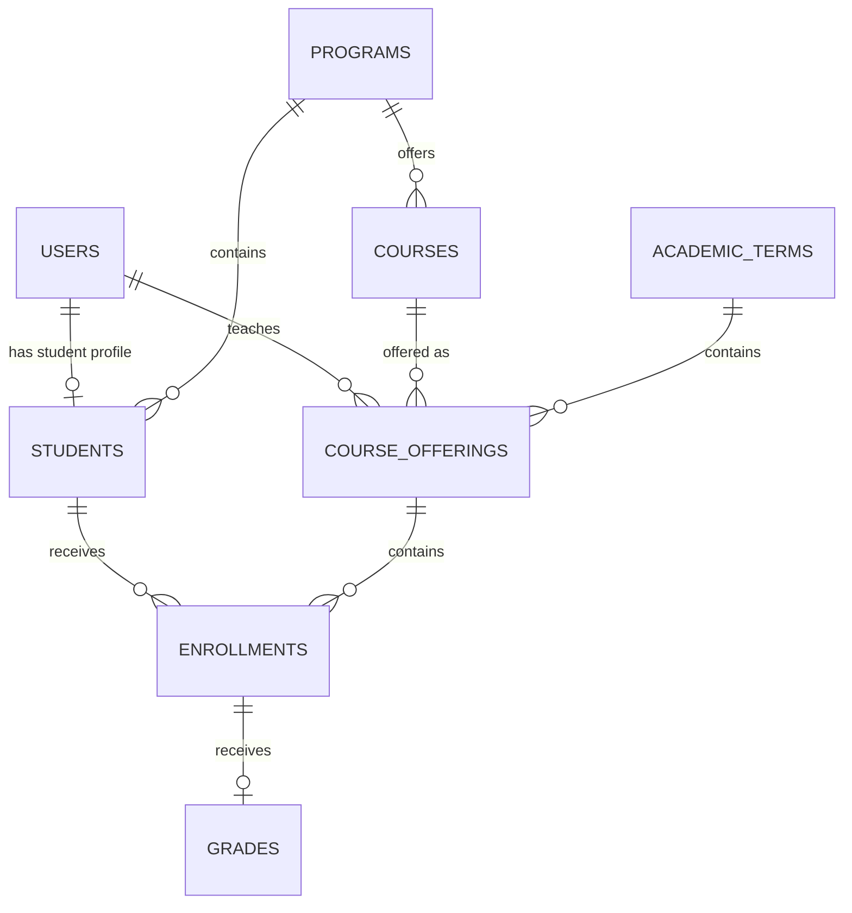

# Entity Relationship Diagram

## Overview

This document describes the database schema and relationships for the Student Information Management System.

## ER Diagram (Mermaid)

## Table Definitions

### users
| Column | Type | Constraints | Description |
|--------|------|-------------|-------------|
| id | bigint unsigned | PK, Auto-increment | Primary key |
| name | varchar(255) | Not null | Full name |
| email | varchar(255) | Unique, Not null | Email address |
| email_verified_at | timestamp | Nullable | Email verification timestamp |
| password | varchar(255) | Not null | Bcrypt hashed password |
| role | enum | Not null, Default: STUDENT | ADMIN, REGISTRAR, INSTRUCTOR, STUDENT |
| status | enum | Not null, Default: ACTIVE | ACTIVE, INACTIVE |
| remember_token | varchar(100) | Nullable | Remember me token |
| created_at | timestamp | Nullable | Creation timestamp |
| updated_at | timestamp | Nullable | Last update timestamp |

**Indexes:**
- Primary: `id`
- Unique: `email`

### students
| Column | Type | Constraints | Description |
|--------|------|-------------|-------------|
| id | bigint unsigned | PK, Auto-increment | Primary key |
| student_number | varchar(20) | Unique, Not null | Format: YYYY-NNNNN |
| user_id | bigint unsigned | Unique, Nullable, FK | Link to users table |
| first_name | varchar(50) | Not null | First name |
| middle_name | varchar(50) | Nullable | Middle name |
| last_name | varchar(50) | Not null | Last name |
| email | varchar(255) | Unique, Nullable | Contact email |
| phone | varchar(20) | Nullable | Phone number |
| address | text | Nullable | Address |
| birth_date | date | Nullable | Date of birth |
| program_id | bigint unsigned | Not null, FK | Academic program |
| year_level | tinyint unsigned | Not null, 1-6 | Year level |
| status | enum | Not null, Default: ACTIVE | ACTIVE, INACTIVE, GRADUATED |
| created_at | timestamp | Nullable | Creation timestamp |
| updated_at | timestamp | Nullable | Last update timestamp |

**Indexes:**
- Primary: `id`
- Unique: `student_number`
- Unique: `user_id`
- Unique: `email`
- Foreign Key: `user_id` → `users.id` (SET NULL)
- Foreign Key: `program_id` → `programs.id` (RESTRICT)
- Index: `program_id`
- Index: `status`
- Index: `year_level`

### programs
| Column | Type | Constraints | Description |
|--------|------|-------------|-------------|
| id | bigint unsigned | PK, Auto-increment | Primary key |
| code | varchar(20) | Unique, Not null | Program code |
| name | varchar(100) | Not null | Program name |
| description | text | Nullable | Description |
| status | enum | Not null, Default: ACTIVE | ACTIVE, INACTIVE |
| created_at | timestamp | Nullable | Creation timestamp |
| updated_at | timestamp | Nullable | Last update timestamp |

**Indexes:**
- Primary: `id`
- Unique: `code`
- Index: `status`

### courses
| Column | Type | Constraints | Description |
|--------|------|-------------|-------------|
| id | bigint unsigned | PK, Auto-increment | Primary key |
| course_code | varchar(20) | Unique, Not null | Course code |
| title | varchar(150) | Not null | Course title |
| units | decimal(3,1) | Not null, Min: 0.5 | Credit units |
| description | text | Nullable | Description |
| status | enum | Not null, Default: ACTIVE | ACTIVE, INACTIVE |
| created_at | timestamp | Nullable | Creation timestamp |
| updated_at | timestamp | Nullable | Last update timestamp |

**Indexes:**
- Primary: `id`
- Unique: `course_code`
- Index: `status`

### academic_terms
| Column | Type | Constraints | Description |
|--------|------|-------------|-------------|
| id | bigint unsigned | PK, Auto-increment | Primary key |
| academic_year | varchar(9) | Not null | Format: YYYY-YYYY |
| semester | enum | Not null | 1st, 2nd, Summer |
| start_date | date | Not null | Term start date |
| end_date | date | Not null | Term end date |
| status | enum | Not null, Default: PLANNED | PLANNED, OPEN, CLOSED |
| created_at | timestamp | Nullable | Creation timestamp |
| updated_at | timestamp | Nullable | Last update timestamp |

**Indexes:**
- Primary: `id`
- Unique: `academic_year`, `semester` (composite)
- Index: `status`
- Index: `start_date`, `end_date`

### course_offerings
| Column | Type | Constraints | Description |
|--------|------|-------------|-------------|
| id | bigint unsigned | PK, Auto-increment | Primary key |
| course_id | bigint unsigned | Not null, FK | Course |
| academic_term_id | bigint unsigned | Not null, FK | Academic term |
| instructor_id | bigint unsigned | Not null, FK | Instructor (user) |
| section | varchar(10) | Not null | Section identifier |
| schedule | varchar(255) | Nullable | Schedule description |
| room | varchar(50) | Nullable | Room number |
| capacity | int unsigned | Not null, Min: 1 | Maximum students |
| status | enum | Not null, Default: OPEN | OPEN, CLOSED, CANCELLED |
| created_at | timestamp | Nullable | Creation timestamp |
| updated_at | timestamp | Nullable | Last update timestamp |

**Indexes:**
- Primary: `id`
- Unique: `course_id`, `academic_term_id`, `section` (composite)
- Foreign Key: `course_id` → `courses.id` (RESTRICT)
- Foreign Key: `academic_term_id` → `academic_terms.id` (RESTRICT)
- Foreign Key: `instructor_id` → `users.id` (RESTRICT)
- Index: `academic_term_id`
- Index: `instructor_id`
- Index: `status`

### enrollments
| Column | Type | Constraints | Description |
|--------|------|-------------|-------------|
| id | bigint unsigned | PK, Auto-increment | Primary key |
| student_id | bigint unsigned | Not null, FK | Student |
| course_offering_id | bigint unsigned | Not null, FK | Course offering |
| enrollment_date | date | Not null | Enrollment date |
| status | enum | Not null, Default: ENROLLED | ENROLLED, DROPPED, COMPLETED |
| created_at | timestamp | Nullable | Creation timestamp |
| updated_at | timestamp | Nullable | Last update timestamp |

**Indexes:**
- Primary: `id`
- Unique: `student_id`, `course_offering_id` (composite)
- Foreign Key: `student_id` → `students.id` (RESTRICT)
- Foreign Key: `course_offering_id` → `course_offerings.id` (RESTRICT)
- Index: `student_id`
- Index: `course_offering_id`
- Index: `status`
- Index: `enrollment_date`

### grades
| Column | Type | Constraints | Description |
|--------|------|-------------|-------------|
| id | bigint unsigned | PK, Auto-increment | Primary key |
| enrollment_id | bigint unsigned | Unique, Not null, FK | Enrollment |
| midterm_grade | decimal(5,2) | Nullable, 0-100 | Midterm grade |
| final_grade | decimal(5,2) | Nullable, 0-100 | Final grade |
| remarks | text | Nullable | Instructor remarks |
| status | enum | Not null, Default: DRAFT | DRAFT, PUBLISHED |
| created_at | timestamp | Nullable | Creation timestamp |
| updated_at | timestamp | Nullable | Last update timestamp |

**Indexes:**
- Primary: `id`
- Unique: `enrollment_id`
- Foreign Key: `enrollment_id` → `enrollments.id` (CASCADE)
- Index: `status`

## Relationship Details

### 1. User ↔ Student (One-to-One, Optional)
- A user may have a student profile
- A student profile may be linked to a user
- `students.user_id` is unique and nullable
- When linked, user must have `role = STUDENT`
- On user deletion: `students.user_id` set to NULL

### 2. Program → Students (One-to-Many)
- A program contains many students
- A student belongs to one program
- `students.program_id` required
- On program deletion: RESTRICT (cannot delete if students exist)

### 3. Program → Courses (One-to-Many)
- A program offers many courses
- A course belongs to one program
- (Implemented via `program_id` on courses table)

### 4. Course → Course Offerings (One-to-Many)
- A course can have many offerings across terms
- An offering is for one course
- On course deletion: RESTRICT

### 5. Academic Term → Course Offerings (One-to-Many)
- A term contains many offerings
- An offering belongs to one term
- On term deletion: RESTRICT

### 6. User (Instructor) → Course Offerings (One-to-Many)
- An instructor teaches many offerings
- An offering has one instructor
- Instructor must have `role = INSTRUCTOR` and `status = ACTIVE`
- On user deletion: RESTRICT

### 7. Student → Enrollments (One-to-Many)
- A student has many enrollments
- An enrollment belongs to one student
- On student deletion: RESTRICT

### 8. Course Offering → Enrollments (One-to-Many)
- An offering has many enrollments
- An enrollment is for one offering
- On offering deletion: RESTRICT

### 9. Enrollment → Grade (One-to-One)
- An enrollment has at most one grade
- A grade belongs to one enrollment
- `grades.enrollment_id` is unique
- On enrollment deletion: CASCADE (grade deleted)

## Key Constraints Summary

### Unique Constraints
1. `users.email` - Unique email per user
2. `students.student_number` - Unique student number
3. `students.user_id` - One student profile per user
4. `students.email` - Unique contact email
5. `programs.code` - Unique program code
6. `courses.course_code` - Unique course code
7. `academic_terms.(academic_year, semester)` - Unique term
8. `course_offerings.(course_id, academic_term_id, section)` - Unique offering
9. `enrollments.(student_id, course_offering_id)` - No duplicate enrollment
10. `grades.enrollment_id` - One grade per enrollment

### Foreign Keys (All RESTRICT except noted)
1. `students.user_id` → `users.id` (SET NULL)
2. `students.program_id` → `programs.id` (RESTRICT)
3. `courses.program_id` → `programs.id` (RESTRICT)
4. `course_offerings.course_id` → `courses.id` (RESTRICT)
5. `course_offerings.academic_term_id` → `academic_terms.id` (RESTRICT)
6. `course_offerings.instructor_id` → `users.id` (RESTRICT)
7. `enrollments.student_id` → `students.id` (RESTRICT)
8. `enrollments.course_offering_id` → `course_offerings.id` (RESTRICT)
9. `grades.enrollment_id` → `enrollments.id` (CASCADE)

### Check Constraints (via Validation)
- `students.year_level` BETWEEN 1 AND 6
- `courses.units` >= 0.5
- `course_offerings.capacity` >= 1
- `grades.midterm_grade` BETWEEN 0 AND 100
- `grades.final_grade` BETWEEN 0 AND 100
- `academic_terms.end_date` > `academic_terms.start_date`

## Seed Data Minimums

| Table | Minimum Records |
|-------|-----------------|
| users | 6 (1 admin, 1 registrar, 2 instructors, 2 students) |
| programs | 3 |
| students | 100 |
| courses | 20 |
| academic_terms | 2 |
| course_offerings | 20 |
| enrollments | 200 |
| grades | 100 |

## Migration Order

1. `create_users_table` (Laravel default)
2. `create_cache_table` (Laravel default)
3. `create_jobs_table` (Laravel default)
4. `create_personal_access_tokens_table` (Sanctum)
5. `add_role_and_status_to_users_table`
6. `create_programs_table`
7. `create_courses_table`
8. `create_academic_terms_table`
9. `create_students_table`
10. `create_course_offerings_table`
11. `create_enrollments_table`
12. `create_grades_table`

## Rollback Considerations

- Tables with foreign keys must be dropped in reverse order
- `php artisan migrate:rollback` handles dependency order
- `php artisan migrate:fresh --seed` rebuilds entire schema